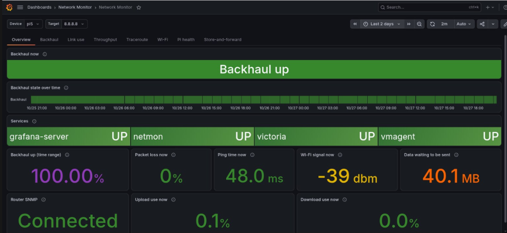
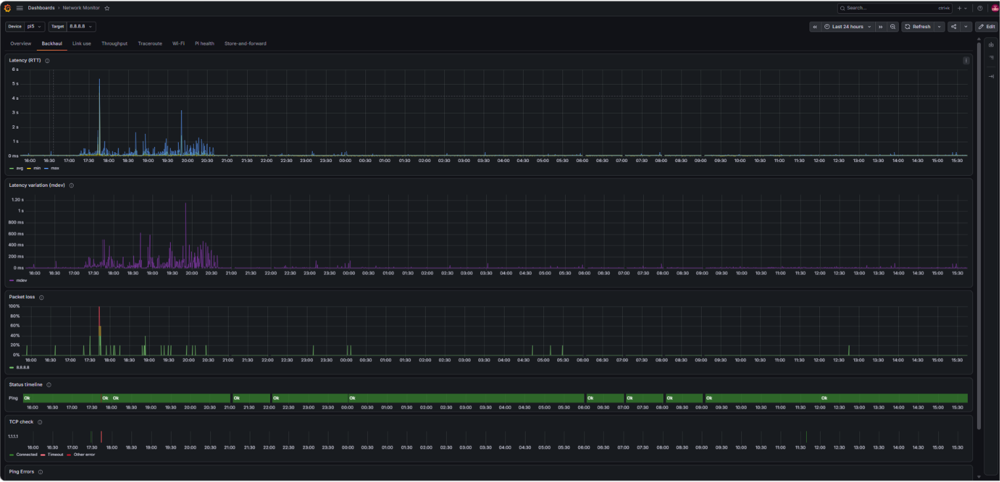
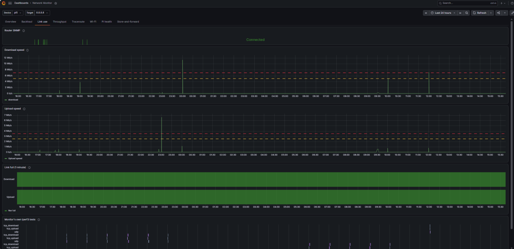
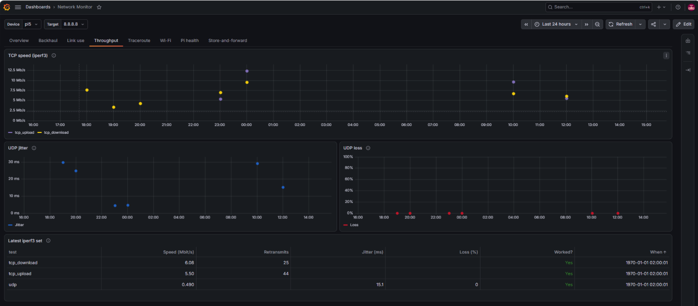
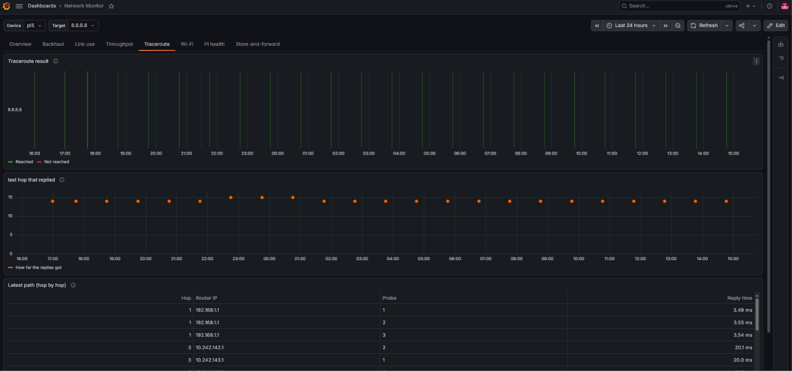
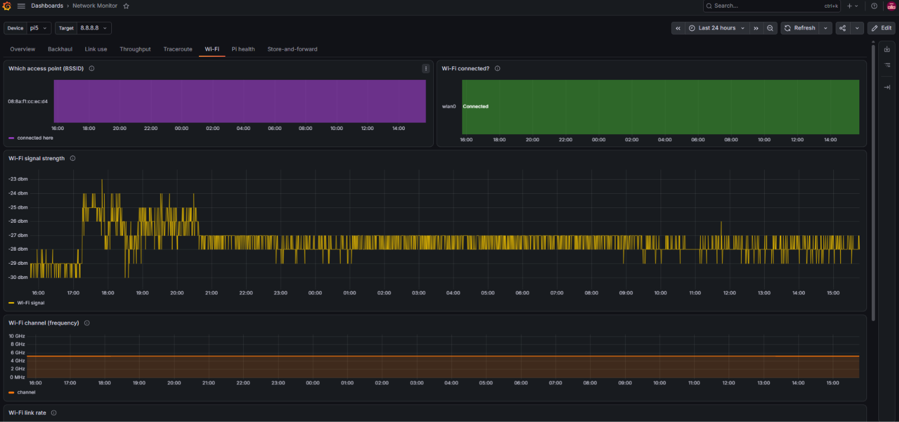
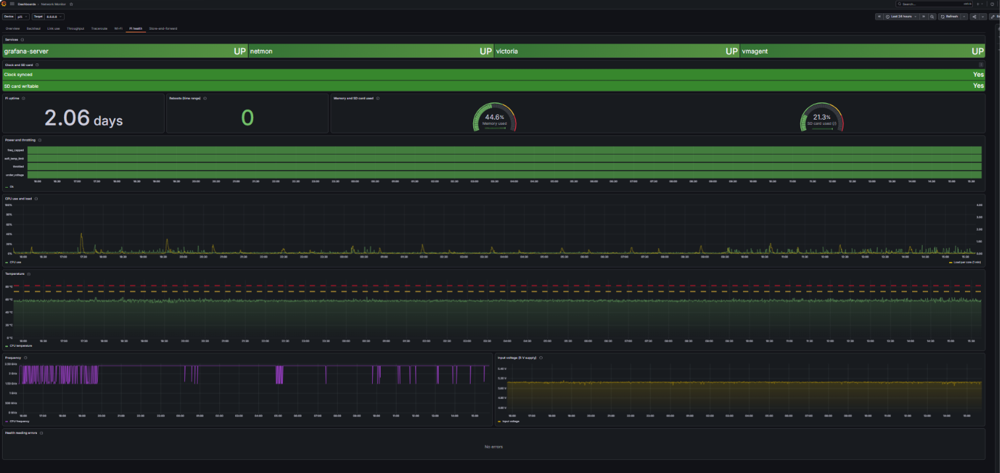
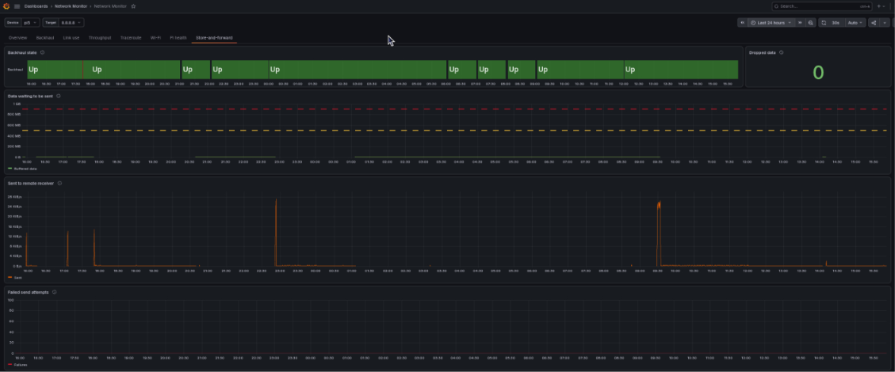

# Dashboard

Screenshots of the eight tabs of the Grafana dashboard
([`infrastructure/grafana/dashboards/network-monitor.json`](../../infrastructure/grafana/dashboards/network-monitor.json)).
The dashboard runs on the Pi on port 3000 and reads only the local database, so
it stays available during an outage. The same dashboard on the receiver shows
the receiver's copy of the data. The purpose of each tab is described in
Section 3.4.4 and Table 3.5 of the project report.

## Overview

Gives the operator the current state of the whole system on one screen, so a
problem can be spotted at a glance before opening the other tabs.

## Backhaul

Shows the quality of the backhaul over time, so the operator can see when it
went down and how its delay and loss changed.

## Link use

Shows how much traffic crosses the router's LTE link in each direction and which
traffic came from the monitor's own iperf3 tests, so the operator can see when
the link is busy or full.

## Throughput

Shows the capacity of the link measured by iperf3, so capacity can be compared
across the day.

## Traceroute

Shows the path from the monitor to the Internet and the last hop that replied,
so the operator can see where along the path an outage lies.

## Wi-Fi

Shows the state of the access link between the monitor and the router, so a
Wi-Fi fault is not mistaken for a backhaul outage.

## Pi health

Shows the state of the monitor itself, so a fault in the monitor is not
mistaken for a network fault.

## Store-and-forward

Shows whether the data is reaching the remote receiver, so the operator can see
how much is still waiting to be sent after an outage.

