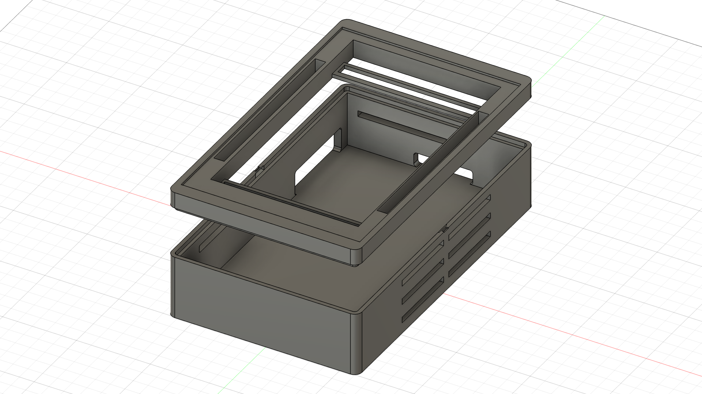
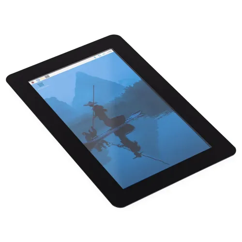
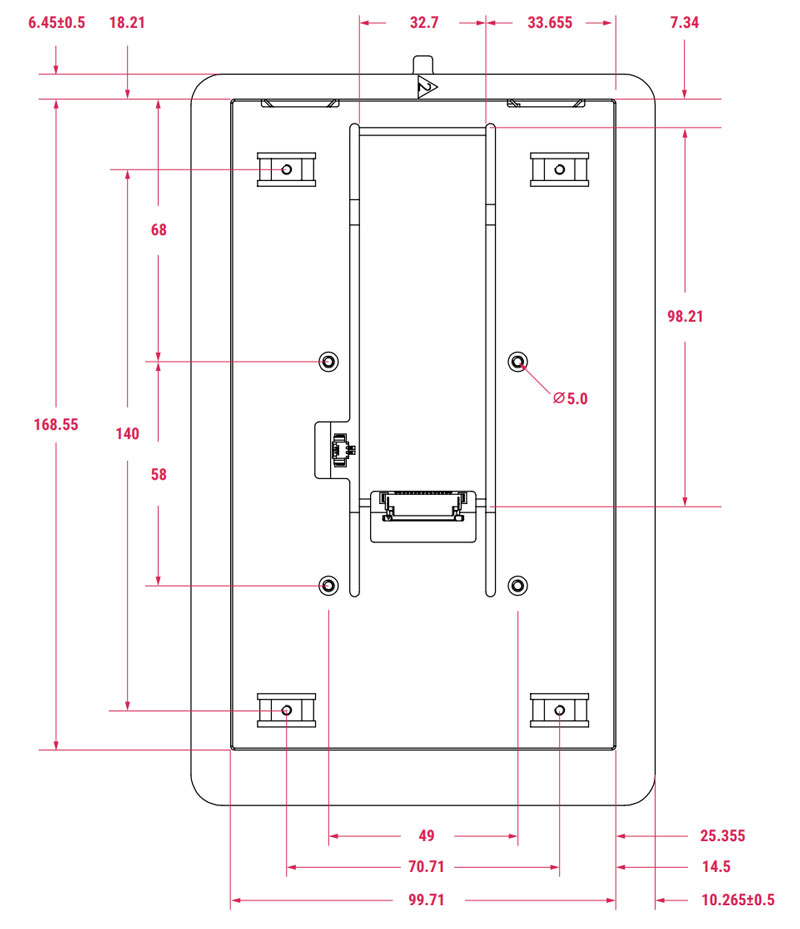

## Author and licence

This enclosure was designed by **Philemon Selaelo Setwaba** (University of
Cape Town, 2026) as part of the EEE4022F final-year project *Embedded Network
Performance Monitor for Network Deployments*.

The design files in this folder (`enclosure.f3d`, the STL files and the
images) are licensed under the
[Creative Commons Attribution-NonCommercial 4.0 International licence (CC BY-NC 4.0)](https://creativecommons.org/licenses/by-nc/4.0/).
You may use, print, share and modify the design for non-commercial purposes,
provided that you credit the author, link to this repository, and state if
you made changes. For example:

> Enclosure design by Philemon Selaelo Setwaba, from
> https://github.com/Philemon-Setwaba/Embedded-Network-Performance-Monitor-for-Network-Deployments-
> (CC BY-NC 4.0).

For commercial use, contact the author.

The two images in `reference/` are not part of this design: they are from
Raspberry Pi Ltd and are **not** covered by the CC BY-NC 4.0 licence.

# Enclosure

The monitor is housed in a two-part box designed in Autodesk Fusion 360 and
3D-printed in ABS. The **base** holds the Raspberry Pi 5 with the Raspberry Pi
Touch Display 2 mounted on its back. The **roof** is a frame that fits around
the screen and clips onto the base, so the box closes without screws and opens
without tools for maintenance. With the screen fitted, the dashboard can be
viewed on site without a laptop and without a working backhaul.

## Main dimensions (mm)

| Part | Outer size (W × L × H) | Details |
| --- | --- | --- |
| Base | 129 × 209 × 43 | 5 mm walls (inner 119 × 199), 5 mm corner radius, ventilation slots in the side walls, openings for the power and network cables |
| Roof | 129 × 209 × 14 | Frame of 121 × 190.5 around the screen, screen window of 100 × 168.59 |

The dimensioned sketches are in `images/base_dimensions.png` and
`images/roof_dimensions.png`.

## Files

| File | Contents |
| --- | --- |
| `enclosure.f3d` | Fusion 360 design (editable), base and roof |
| `stl/enclosure_base.stl` | Base |
| `stl/enclosure_roof.stl` | Roof |
| `stl/enclosure_print_plate.stl` | Base and roof together, laid out for printing |
| `images/design_v1.png` | Final design (base and roof), as printed |
| `images/design_v0.png` | Earlier design, before the roof was changed |
| `images/base_render.png`, `images/roof_render.png` | Renders of each part |
| `images/base_dimensions.png`, `images/roof_dimensions.png` | Dimensioned sketches |
| `images/printed_*.jpeg` | Photos of the printed box with the screen running the dashboard |
| `images/slicer_printer.png`, `images/slicer_filament.png` | Printer and filament settings used |
| `reference/touch_display_2.webp` | Product photo of the Raspberry Pi Touch Display 2 (Raspberry Pi Ltd) |
| `reference/touch_display_2_mechanical.jpg` | Mechanical drawing of the Touch Display 2, in mm (Raspberry Pi Ltd) |

## Printing

| Setting | Value |
| --- | --- |
| Printer | Creality K1 Max |
| Slicer | Creality Print 7.3.0 |
| Filament | Creality CR ABS |
| Nozzle | 0.4 mm |
| Layer height | 0.20 mm (Standard profile) |
| Bed | Smooth PEI plate |

## Assembly

1. Mount the Raspberry Pi 5 on the back of the Touch Display 2 and connect the
   display cable.
2. Place the screen with the Pi into the base, with the Pi's ports facing the
   cable openings.
3. Connect the power cable (and the network cable, if used) through the
   openings in the side walls.
4. Press the roof onto the base until it clicks into place.

## Reference: Raspberry Pi Touch Display 2

The enclosure was sized around the Raspberry Pi Touch Display 2 (7-inch), with
the Raspberry Pi 5 mounted on its back. Its outer size is 120.2 × 189.3 mm, so
the roof frame (121 × 190.5 mm) fits around it with a small clearance.

**Source and copyright.** Both images are from Raspberry Pi Ltd: the product
photo, and the mechanical drawing from the
[Raspberry Pi Touch Display 2 – 7″ Portrait](https://pip-assets.raspberrypi.com/categories/1083-raspberry-pi-touch-display-2/documents/RP-010429-MM-3-touch-display-2-7-inch-product-brief.pdf)
product brief (Raspberry Pi Ltd, October 2026). They are included for
reference only and are **not** covered by the CC BY-NC 4.0 licence of this
folder.